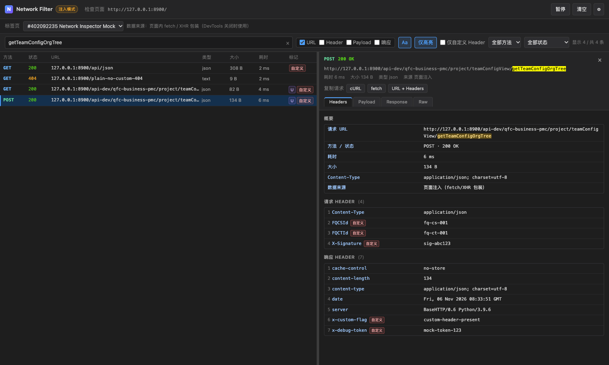

# Network Inspector（Chrome MV3 扩展）

> DevTools Network 面板不够用时的补充：把抓到的请求按 **URL / Header / Payload / 响应体** 四路检索，标记自定义 Header，折叠查看 JSON，一键复制 cURL / fetch。

**它解决什么问题**：DevTools 只能按 URL 过滤，看不到"哪个请求的响应体里出现了某个关键字"，也不能标记自定义 Header。本扩展在官方 `chrome.devtools.network` 数据之上补上全文搜索、命中标记、JSON 树、二进制下载与命令复制；DevTools 关闭时还能用页面注入模式继续抓包。

**功能概览**

- 四路搜索：URL（完整 URL / path / query，含编码与解码形式）、Header、Payload、响应体，命中处用 `U/H/P/R` 标记。
- 自定义 Header 识别与"仅自定义 Header"过滤，支持额外白名单 / 黑名单。
- JSON 折叠树、节点复制值 / 复制路径、大数组分页；请求体 JSON 同样默认格式化展示，表单自动转字段表格。
- 超大响应保护（默认 1 MB 不解析、只给下载）、二进制 / SSE 下载。
- 一键复制 cURL / fetch / URL + Headers，按 Content-Type 正确生成请求体。
- 两种模式：DevTools 面板（主）与页面注入（DevTools 关闭时补充）。



**零构建**：全部为原生 HTML/CSS/JS，解压后在 `chrome://extensions/` 选择"加载已解压的扩展程序"即可使用，无需 `npm install`。

---

## 一、两种工作模式

| | DevTools 面板模式（主方案） | 页面注入模式（补充方案） |
|---|---|---|
| 打开方式 | F12 打开 DevTools → 顶部标签栏 **Network Filter** | 点击扩展图标，弹出独立面板窗口（`panel.html`） |
| 数据来源 | `chrome.devtools.network.onRequestFinished` 的 HAR 条目 + `entry.getContent()` | MAIN world 注入脚本包装 `fetch` / `XMLHttpRequest` |
| 准确度 | 高：浏览器原生网络栈记录，含真实耗时、状态、响应头、缓存信息 | 中：只能看到页面实际发起的 fetch/XHR，拿不到浏览器自动添加的完整请求头 |
| 前提 | 必须打开 DevTools 并切换到面板 | 页面必须在**扩展安装之后**新打开或刷新过（注入脚本 `document_start` 执行） |
| 数据留存 | 只存在于当前 DevTools 会话；DevTools 关闭即停止 | 由 background 按 tabId 维护环形缓冲（默认 500 条，可配置），并镜像到 `chrome.storage.session` |

面板顶部左侧的徽标会明确显示当前处于 **DevTools 模式** 还是 **注入模式**；注入模式下会额外显示标签页选择器。

> 模式不由用户手动切换，而由"从哪里打开页面"决定：在 DevTools 里点开 → DevTools 模式；在普通标签页/弹窗打开 `panel.html` → 注入模式。

**怎么选**：日常调试优先用 DevTools 面板模式（数据最完整，含真实耗时与完整响应头）；需要在不打开 DevTools 的情况下持续观察页面请求，或想确认页面脚本实际发出了哪些 `fetch` / `XHR`，用注入模式。

---

## 二、安装

1. 打开 `chrome://extensions/`，右上角开启 **开发者模式**。
2. 点击 **加载已解压的扩展程序**，选择本目录 `network-inspector/`（包含 `manifest.json` 的那一层）。
3. 打开任意页面 → F12 → 在 DevTools 标签栏右侧点 `»`（更多标签）→ 选择 **Network Filter**。

注意：

- 扩展需要在 DevTools **打开之前**就已加载，否则新装的扩展面板要等下一次打开 DevTools 才会出现。
- Chrome 137 起，命令行 `--load-extension` 默认被禁用，请使用上面的图形界面加载方式。
- 本扩展最低支持 Chrome 111（`content_scripts.world = "MAIN"`）。

---

## 三、功能说明

### 1) 关键字搜索
- 单个搜索框，可分别勾选 **URL / Header / Payload / 响应** 四路匹配范围（默认全开）。
- URL 范围覆盖完整 URL、pathname 与 query string，并同时匹配**原始编码**与 **URL 解码后**的文本（`%2F`、`%E4%B8%AD`、`+` 等），从请求详情里复制的片段可直接搜到。
- `Aa` 按钮切换大小写敏感；默认不敏感。关键字会自动去掉首尾空白与零宽字符，避免复制时带入不可见字符。
- 列表按关键字**实时过滤**；点击 **仅高亮** 后改为"只高亮不过滤"，列表保留全部请求，命中位置在详情里用 `<mark>` 高亮。
- 列表 `标记` 列用 `U` / `H` / `P` / `R` 标出命中的段落（URL / Header / Payload / Response），一眼看出命中在哪一段。
- 关键字按字面量匹配，`?`、`&`、`=` 等特殊字符不会被当作正则或分词。

### 2) 自定义 Header 标记
- 内置一份标准 Header 白名单（`accept`、`content-type`、`cookie`、`sec-fetch-*`、`sec-ch-ua-*`、`cache-control` 等），不在白名单内的头视为"自定义"。
- 请求头与响应头都会检测；列表显示 `自定义` 标记。
- 勾选 **仅自定义 Header** 只保留含自定义头的请求。
- 设置里可以维护 **额外白名单**（认为是标准头）与 **黑名单**（明确视为自定义），一行一个，大小写不敏感。

### 3) JSON 响应可视化
- 对象 / 数组以可折叠树展示，默认只展开根节点与第一层（`state` 中 `_expanded` 初始为 `['$']`），避免大结构卡顿。
- 数组显示 `Array(n)`，对象显示 `{n}` 键数量。
- 每个节点提供 **复制值** 与 **复制路径**（路径形如 `$[0].items[2].name`）。
- 数组/对象超过 100 个成员时分页加载（"显示更多"），避免一次性渲染。
- 可在 `[JSON 树] / [原始]` 之间切换。

### 3.1) 请求体（Payload）展示
- JSON 请求体默认渲染为**格式化折叠树**（与响应区一致：折叠、`Array(n)`、复制值/复制路径、超过 100 项分页），可在 `[格式化 JSON] / [原始 body]` 间切换，选择在面板内保持。
- JSON 判定以 Content-Type（`application/json`、`+json`）为主；类型缺失或错误时，若内容能 `JSON.parse` 成功也按 JSON 展示并提示；声明为 JSON 但解析失败则回退纯文本并提示。
- `application/x-www-form-urlencoded` 显示**解码后的字段表格**（`+` 视为空格），可切换到原始串。
- `multipart/form-data` 显示字段列表，文件字段标注文件名与大小占位。
- 纯文本按原文展示；二进制只给大小与类型提示。
- 超过解析阈值（默认 1 MB）时不做解析，只给大小 / 类型与复制、下载入口。
- **复制原始 body** 始终输出字节级原始内容；**复制格式化 JSON** 输出缩进后的 JSON，两者互不污染。
- 请求体区域同样支持详情内局部搜索，命中路径会自动展开。

### 4) 文件流 / 二进制下载
- 响应为 `application/octet-stream`、`image/*`、`application/pdf`、`zip`、Excel、`protobuf`、`text/event-stream` 等二进制/流类型时，详情页提供 **下载原始响应**。
- 实现方式：DevTools 模式下 `getContent` 返回 `encoding: "base64"` 的内容 → `atob` 还原字节 → 构造 `Blob` → `chrome.downloads.download({ saveAs: true })`；注入模式下直接使用捕获到的 base64 原始数据。
- 文件名按 URL 路径 + MIME 推断扩展名。

### 5) 超大响应体保护
- 阈值：`parseThresholdKB`，默认 **1024 KB（1 MB）**，可在设置中修改。
- 超过阈值：**不解析、不渲染 JSON 树**，只显示大小与 Content-Type，并直接提供 **下载原始响应** / **下载为 txt**。
- 注入模式另有 `maxCaptureMB`（默认 5 MB）：页面内读取响应流时超过该大小会截断，避免内存爆掉；截断会在详情里提示。
- 注入模式读取流式响应（SSE 等）有 **8 秒上限**，超时会停止读取并保留已接收部分，同时给出提示。

### 6) 列表 / 详情 / 其他
- 列表列：方法、状态码、URL、耗时、大小、类型。
- 详情多 Tab：`Headers` / `Payload` / `Response` / `Raw`。
- 按 **方法**、**状态码段**（2xx/3xx/4xx/5xx/失败）过滤。
- **暂停 / 继续**捕获、**清空**当前列表（DevTools 模式下为仅清空界面缓存）。
- 显示当前检查的页面 URL；`onNavigated`（或页面导航）时自动清空并刷新 URL。

### 7) 一键复制
复制请求，支持三种格式：
1. **cURL**：可直接粘贴到 bash/zsh 执行的单条命令。
2. **fetch 代码片段**：可直接粘贴进 Console 执行。
3. **URL + Headers 文本**：纯文本形式。

cURL 生成规则（保证复制即可执行）：
- 形式为 `curl 'URL' \` 换行 `  -X POST \` 换行 `  -H 'K: V' \` … `  --data-raw '…'`，多行用反斜杠续行，单条命令。
- 单引号转义统一使用 `'\''`，不需要手动改引号。
- 按 `Content-Type` 分派请求体：
  - `application/x-www-form-urlencoded` → `--data-raw`（保留原始编码串）；
  - JSON → `--data-raw`，**保留原始压缩格式，不做美化**（避免改变语义）；
  - `multipart/form-data` → 多个 `-F` 还原字段；文件字段输出 `-F 'file=@/path/to/file'` 占位并提示替换真实路径；
  - 二进制请求体 → `--data-binary @/path/to/file` 占位。
- `Authorization` / `Cookie` 等敏感头**照常保留、不做脱敏**；请求含敏感头时复制按钮会标注"含敏感信息"，复制后的 toast 也会提示。
- 跳过 `content-length`（由 curl 自行计算）；multipart 时不重复输出 `Content-Type`。

复制请求体：
- **复制原始 body**：按原样输出；
- **复制格式化 JSON**：仅在 body 是合法 JSON 时美化缩进，否则回退为原文并提示；
- `FormData` 会给出可读结构（字段名 / 值 / 文件名与大小）。

所有复制操作都有 toast 反馈；cURL 的 toast 会说明"已生成可直接执行的命令"。

---

## 四、设置项

点击面板右上角齿轮：

| 设置 | 默认 | 说明 |
|---|---|---|
| 缓冲上限 `maxEntries` | 500 | 注入模式每个标签页保留的请求条数 |
| 解析阈值 `parseThresholdKB` | 1024 KB | 超过则不解析 JSON、只给下载 |
| 捕获上限 `maxCaptureMB` | 5 MB | 注入模式读取响应流的最大截断值 |
| 额外白名单 | 空 | 视为标准 Header 的名称，一行一个 |
| 自定义黑名单 | 空 | 明确视为自定义 Header 的名称，一行一个 |

设置保存在 `chrome.storage.local`，改动后立即生效（缓冲上限会立即裁剪）。

---

## 五、权限说明

`manifest.json` 申请：

- `scripting`：注册/注入 MAIN world 抓包脚本（注入模式）。
- `storage`：保存设置；`chrome.storage.session` 用于恢复注入模式的缓冲镜像。
- `tabs`：面板按 tabId 切换查看不同标签页的数据，读取标签页 URL/标题。
- `downloads`：保存捕获到的原始响应体。
- `activeTab`：点击扩展图标时获取当前标签页。
- `host_permissions: ["<all_urls>"]`：注入模式需要覆盖任意站点以包装 `fetch`/`XHR`；同时用于扩展页面对本地 mock 等地址发起请求。
- `devtools_page`：注册 DevTools 面板（DevTools 模式）。

扩展不发送任何数据到远端，所有数据只在本机内存/本地存储中处理。

---

## 六、本地 mock 自检

`mock/` 提供了零依赖的验证环境：

```bash
cd network-inspector/mock
python3 server.py          # 监听 127.0.0.1:8899
```

然后浏览器打开 `http://127.0.0.1:8899/`：

- 页面提供按钮触发各类请求：JSON、数组、超大响应（约 1.3 MB）、二进制流（2 MB）、PNG、500 错误、慢请求、SSE 流、302 重定向、POST JSON、表单、multipart。
- 页面会同时演示自定义请求头（`X-Debug-Token`）与自定义响应头（`X-Debug-Token`、`X-Custom-Flag`、`X-Array-Count` 等）。
- 搜索关键字示例：`needle`（只在部分响应正文中出现）、`mock-token`（出现在 header 中）、`X-Custom-Flag`（只在响应头）。

已完成的自动化验证（CDP 驱动真实 Chrome，Chrome 156）：

**注入模式（真实抓包链路）**
- 页面 `runAll()` 触发 12 条请求，面板收到 12 条，列表/详情正常。
- 关键字 `needle`：Header-only → 0 条；加响应 → 10 条；大小写不敏感 `NEEDLE` → 10 条，关闭不敏感 → 0 条。
- 仅高亮模式：列表仍显示 12 条，详情命中处出现 `<mark>`。
- 自定义 Header：`X-Debug-Token` 等被正确标记，`sec-fetch-*`、`sec-ch-ua-*` 不再误判。
- JSON 树：`Array(12)` 正确，展开后节点数 13；复制值/路径可用。
- 超大响应 1,344,243 字节 → 不渲染树，仅提示超阈值 + 下载按钮。
- 二进制 2,097,152 字节 → base64 解码后字节数完全一致。
- cURL：POST JSON 输出单条可直接执行命令，`--data-raw` 保留原始压缩 JSON；multipart 输出多个 `-F`（文件字段为 `@/path/to/file` 占位）。
- 截图：`docs/panel-inject.png`。

**URL 搜索修复验证（2026-11-06，22 项断言全部通过）**
- 取消 URL 范围、其余范围全开并勾选"仅自定义 Header" → 0 条（精确复现"关键字只在 path 中却搜不到"的问题）。
- 只勾 URL + "仅自定义 Header" → path 含关键字的 2 条请求均命中，行上显示 `U` + `自定义`。
- 全范围 + "仅自定义 Header" → 仍命中 2 条，确认 `customOnly` 与其他条件是 AND、不会清空结果。
- `中文` 与 `%E4%B8%AD%E6%96%87`、`a/b c` 与 `a%2Fb+c`、含 `? & =` 的 query 均可命中；关键字带首尾空格 / 零宽字符仍命中。
- 详情顶部 URL 与 Headers 概要中的 URL 均出现 `<mark>` 高亮。
- 截图：`docs/panel-search.png`。

**DevTools 模式（HAR + getContent 数据链路）**
- 面板以 DevTools 模式启动（`modeBadge` = `DevTools 模式`，标签页选择器隐藏），页面 URL 正确显示。
- 用 8 条真实 mock 数据构造 HAR 条目（含 `getContent`，二进制用 `encoding: "base64"`）喂入 `onRequestFinished`：
  - 列表 8 条，状态码/耗时/大小/MIME 正常；
  - 搜索 `needle` → 5 条命中（form、echo、array、json、error）；
  - `Array(12)`、超阈值跳过解析、base64 图片、`postData` → cURL 均正确；
  - 触发 `onNavigated` → 列表清空、URL 更新。
- `devtools_page` 已确认在真实 DevTools 中加载，`chrome.devtools.panels.create(...)` 回调正常触发（扩展 ID `kdjgpdofhdkcokohiinjodefekgjiidg`）。
- 截图：`docs/panel-devtools-sim.png`。

未能在自动化中完成的：**用鼠标在 DevTools UI 里点开扩展面板标签**（DevTools 前端 DOM 为 Shadow DOM + 内部模块，自动化点击不稳定）。该步骤为人工可验证的一步，见"安装"第 3 步。

---

## 七、已知限制

1. **不能读取 DevTools Network 面板本身的数据**：Chromium 不开放该接口，因此 DevTools 模式也必须通过官方 `chrome.devtools.network.onRequestFinished` 重新采集；注入模式则完全自建通道。
2. **DevTools 面板模式只在面板存在时抓取**：未打开 DevTools/未切到本面板时不会记录；面板创建之前的请求也不会出现（HAR 从 `onRequestFinished` 监听开始）。
3. **DevTools 关闭后不抓包**：需要持续抓取时请用注入模式（或保持 DevTools 打开）。
4. **`getContent` 的限制**：
   - 响应体可能返回空字符串（请求已被浏览器清理、未写入缓存、或跨进程取不到）；
   - 二进制返回 `encoding: "base64"`，需要解码后才能下载；
   - `text/event-stream` 这类流只能拿到**已接收的部分**，且请求未结束时 `onRequestFinished` 不会触发；
   - 部分响应体需要点击下载时才按需读取（本扩展对大响应采用延迟读取）。
5. **注入模式的局限**：
   - 只能捕获页面脚本发起的 `fetch` / `XMLHttpRequest`；**WebSocket、EventSource、`navigator.sendBeacon`、WebTransport** 不覆盖（通过 fetch 的 SSE 可见已接收片段）；
   - 无法获取页面脚本没有显式设置的请求头（`Sec-*`、`Cookie` 等由浏览器注入的头只能看到部分）；
   - `XMLHttpRequest` 的 `responseType` 为 `blob` / `arraybuffer` 时按字节读取并转 base64；`document` 类型只记录类型不记录内容；
   - 页面 CSP 极严格或脚本被内联执行时序影响时，`document_start` 注入仍可能晚于极早期请求；
   - 数据在 service worker 内存中，空闲回收时依赖 `chrome.storage.session` 镜像恢复（最多约 8 MB，超出会丢弃旧数据）。
6. **超大响应保护是"不解析"而非"完整保留"**：超过 `parseThresholdKB` 不会构建树；注入模式超过 `maxCaptureMB` 会截断，下载得到的是截断后的数据（详情会提示）。
7. **跨域与受限响应头**：某些响应头在跨域场景下不会暴露给页面（注入模式受 CORS 限制）；DevTools 模式可从 HAR 获得更完整的响应头。
8. **下载需要用户手势**：`saveAs: true` 会弹出保存对话框；无用户手势时浏览器可能拦截。
9. **复制内容不做脱敏**：含 `Authorization` / `Cookie` 的命令会原样复制，请勿分享到不可信环境。
10. **SSE / 长连接**：注入模式有 8 秒读取上限；DevTools 模式需等请求结束才会有条目。

---

## 八、目录结构

```
network-inspector/
├── manifest.json          MV3 清单（devtools_page + content_scripts + 权限）
├── devtools.html/js       注册 DevTools 面板 "Network Filter"
├── background.js          service worker：按 tabId 环形缓冲、session 镜像、面板端口
├── inject.js              MAIN world：包装 fetch/XHR、读取 clone/responseText、上报
├── bridge.js              ISOLATED world：转发页面消息到 background，下发配置
├── panel.html             面板页面（三种来源共用同一套 UI）
├── panel.css              UI 样式
├── panel-utils.js         状态、格式化、高亮、Header 白名单、设置
├── panel-data.js          HAR / 注入两种数据源、过滤与搜索
├── panel-copy.js          cURL / fetch / 原始文本 / 请求体复制 / 下载
├── panel-render.js        列表与详情渲染
├── panel-response.js      Response Tab、JSON 树、超大响应保护
├── panel-main.js          事件绑定与初始化
├── mock/
│   ├── server.py          零依赖 mock 服务（127.0.0.1:8899）
│   └── mock.html          验证页面
├── docs/                  README 引用的截图
├── .gitignore             排除构建产物、日志、编辑器/系统文件
└── README.md              本文档
```

### 关键实现点

- **clone 时序**：`fetch` 包装必须在返回 Promise 之前**同步**注册 `responsePromise.then(r => cloneHolder = r.clone())`，保证 clone 早于页面自身读取；随后在独立异步流程里 await 真实响应并读取 clone 的流。
- **流式读取**：`readStreamLimited(stream)` 边读边累计，达到 `maxCaptureMB` 截断，并有 8 秒定时器 `reader.cancel()`，避免 SSE 永不结束导致请求永不上报。
- **二进制通道**：`chrome.runtime` 消息只能传 JSON，二进制统一转 base64 字符串；下载时 `atob` 还原为 `Uint8Array` 再包成 `Blob`。
- **单引号转义**：`'` → `'\''`，保证 cURL 可直接执行。
